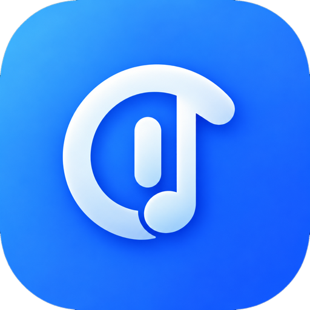

# CupTune

**Your Music, Your Vibe.**

Aplikasi penemuan dan pemutaran musik berbasis web — mobile-first, tema gelap, dan bisa dipasang sebagai PWA.

*by **MkdirCup***

---

## Daftar Isi

- [Fitur](#fitur)
- [Tech Stack](#tech-stack)
- [Lirik](#lirik)
- [Pembuat](#pembuat)

## Fitur

- **Penemuan musik** — Beranda dengan chart populer, pencarian, dan playlist.
- **Pemutar lengkap** — mini-player, pemutar layar penuh, antrean, dan kontrol lock screen lewat Media Session.
- **Audio lokal** — putar MP3/M4A dari perangkat; metadata dibaca dari tag ID3v2.3/2.4.
- **Pustaka & playlist** — simpan lagu, buat playlist, riwayat putar; semuanya tersimpan di perangkat (IndexedDB).
- **Lirik** — lirik sinkron (LRC) dari LRCLIB, dengan pencocokan ketat dan penyesuaian ±0,5 detik.
- **Equalizer & visualizer** — equalizer, serta visualizer nyata untuk audio lokal.
- **PWA** — dapat dipasang ke layar utama dengan ikon maskable; Wake Lock menjaga layar tetap menyala saat memutar.
- **Aman by design** — API key hanya hidup di server, dengan rate limit dan cache.

## Tech Stack

| Lapisan | Teknologi |
|---|---|
| Framework | Next.js 14 (App Router) |
| Bahasa | TypeScript (strict) |
| Styling | Tailwind CSS |
| State | Zustand |
| Ikon | Lucide |
| Penyimpanan | IndexedDB + localStorage |
| Pemutaran | IFrame Player API + `<audio>` |
| Lirik | LRCLIB |

## Lirik

- **Sumber:** [LRCLIB](https://lrclib.net) — database lirik komunitas dengan API publik tanpa kunci, diakses lewat proxy `app/api/lyrics`.
- **Sinkronisasi:** lirik sinkron hanya tampil jika data memuat timestamp LRC; jika tidak, tampil lirik biasa atau pesan "Lirik belum tersedia". Lirik tidak pernah dibuat atau ditebak.
- **Pencocokan:** otomatis hanya jika judul cocok dan selisih durasi ≤ 5 detik. Jika ragu, pengguna dapat memilih manual (maks. 40 pilihan tersimpan).
- **Pembersihan judul:** "Official Video", "[Lyrics]", dan format "Artis - Judul" dinormalisasi.

> [!NOTE]
> Lirik tetap berhak cipta, dan LRCLIB adalah sumber komunitas, bukan penyedia berlisensi. Pertimbangkan penyedia berlisensi (mis. Musixmatch) sebelum rilis publik atau komersial.

## Pembuat

**CupTune** dibuat dan dikembangkan oleh **MkdirCup**.

---

© 2026 CupTune — Made by **MkdirCup**

